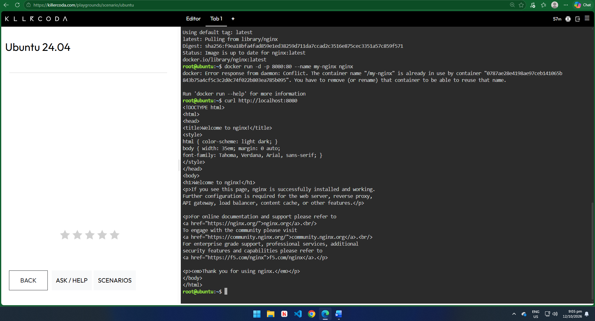

Docker Deployment: Nginx

## Deployment Commands

| Command | Explanation |
|---------|-------------|
| `docker pull nginx` | Downloaded the official Nginx image from Docker Hub. |
| `docker run -d -p 8080:80 --name my-nginx nginx` | Started the Nginx container in the background and mapped host port 8080 to container port 80. |
| `curl http://localhost:8080` | Sent an HTTP request to confirm the web server returned the "Welcome to nginx!" page. |

## Container Lifecycle

| Command | Explanation |
|---------|-------------|
| `docker ps` | Listed all currently running containers. |
| `docker stop my-nginx` | Stopped the running Nginx container. |
| `docker ps -a` | Showed all containers, including stopped ones, to verify that my-nginx had stopped (status "Exited"). |
| `docker rm my-nginx` | Permanently removed the stopped container. |

## Screenshots

