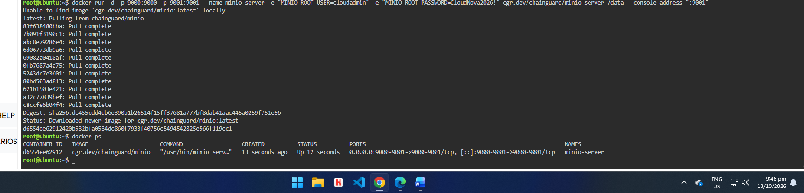
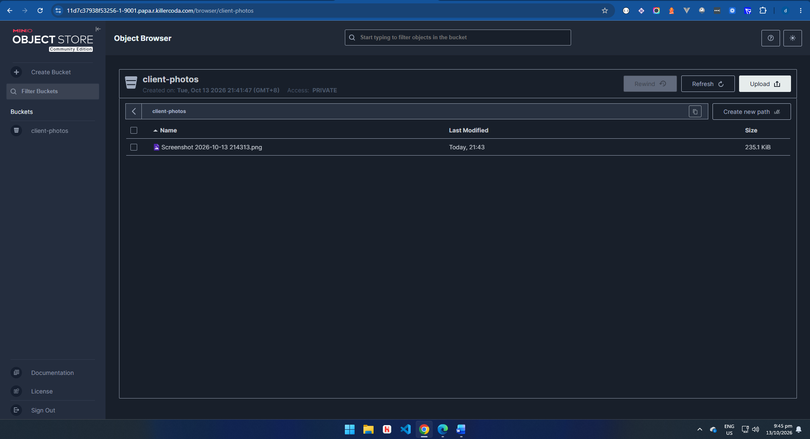

# MinIO Deployment

## Docker Command Used

The original lab command uses the `minio/minio` image, but that image is no longer available on Docker Hub (`pull access denied`). I used the Chainguard MinIO image instead. Everything else is unchanged.

```bash
docker run -d -p 9000:9000 -p 9001:9001 --name minio-server \
-e "MINIO_ROOT_USER=cloudadmin" \
-e "MINIO_ROOT_PASSWORD=CloudNova2026!" \
cgr.dev/chainguard/minio server /data --console-address ":9001"
```

I verified the container was running with:

```bash
docker ps
```

## Port Used for the Web Console

Port **9001** (MinIO Console). Port 9000 is used by the S3 API.

## Bucket Created

`client-photos` (Access: Private)

## What the `-e` Flags Did

The `-e` flags set environment variables inside the container when it starts:

- `MINIO_ROOT_USER=cloudadmin` set the administrator username.
- `MINIO_ROOT_PASSWORD=CloudNova2026!` set the administrator password.

I used these credentials to log in to the MinIO web console. Setting them at startup meant I did not have to configure the server manually.

## Steps Taken

1. Launched the KillerCoda Ubuntu Playground.
2. Ran the Docker command to pull and start the MinIO server.
3. Verified the container was running with `docker ps`.
4. Opened port 9001 through the KillerCoda Traffic / Ports menu.
5. Logged in to the MinIO Console with the credentials above.
6. Created the `client-photos` bucket.
7. Uploaded a test image to the bucket.

## Screenshots




