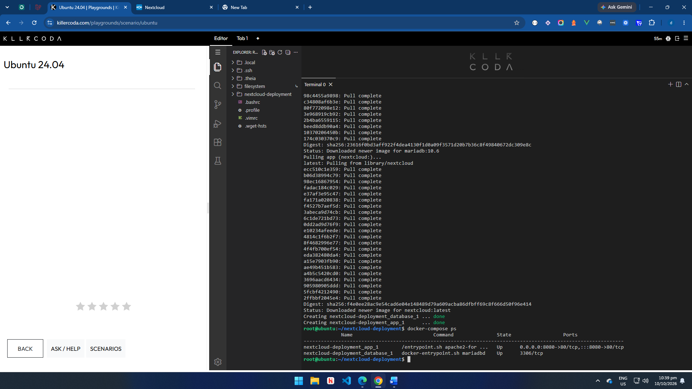
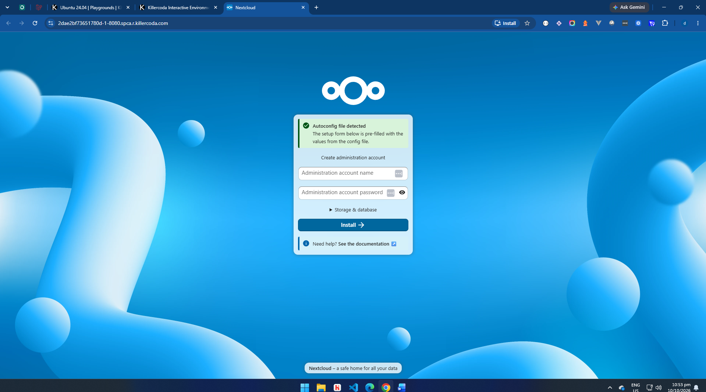
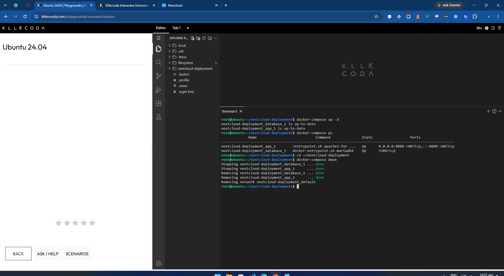

Laboratory 06: Cloud Deployment Engineer

## Mission Overview
Deployed a two-tier private cloud storage application (Nextcloud + MariaDB)
using Docker Compose on a KillerCoda Ubuntu playground, treating the
infrastructure as code.

## Objectives
- Explain multi-tier architecture
- Understand the structure and purpose of docker-compose.yml
- Create configuration files with nano
- Deploy a multi-container application with Docker Compose
- Document the work in Markdown and push it to GitHub

## Commands Executed
mkdir nextcloud-deployment
cd nextcloud-deployment
nano docker-compose.yml
docker-compose up -d
docker-compose ps
docker-compose down

## Screenshots
- 
- 
- 

## Skills Learned
- Writing YAML configuration files
- Using nano in the Linux terminal
- Deploying and removing multi-container stacks with Docker Compose
- Understanding service networking and environment variables
- Documenting infrastructure as code
